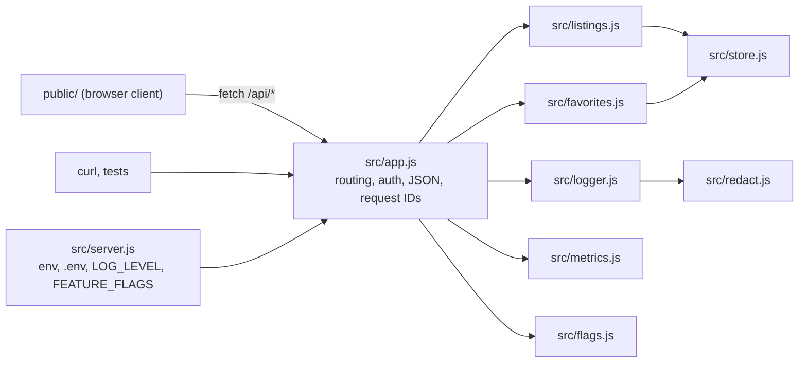
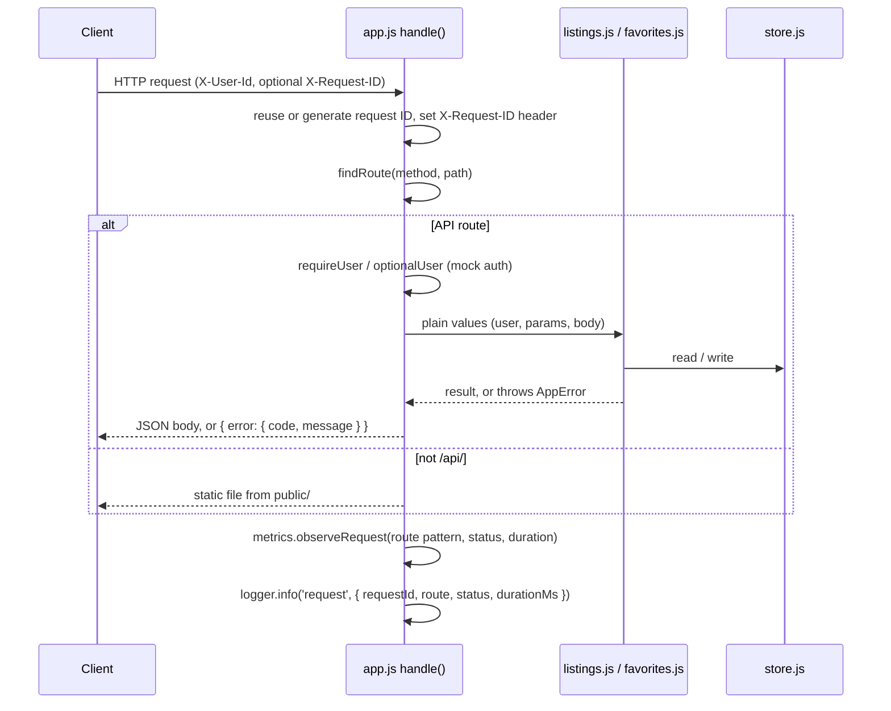

# Architecture

sakura-market-mini is one Node.js process with no runtime dependencies. All
data lives in memory in `src/store.js` and resets on restart.

## Modules

## One request

- Errors thrown as `AppError` become their status and code. Anything else
  becomes `500 internal`, and the redacted error is logged as
  `unhandled_error` with the request ID.
- Routes and their responses are described in [api/openapi.json](api/openapi.json)
  and rendered to [api/README.md](api/README.md).
- The browser client keeps page state in `public/controller.js` and only talks
  to the API.
